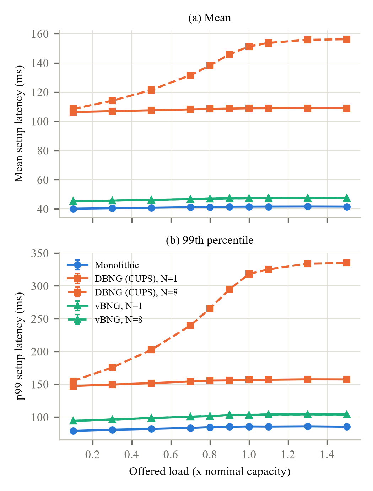
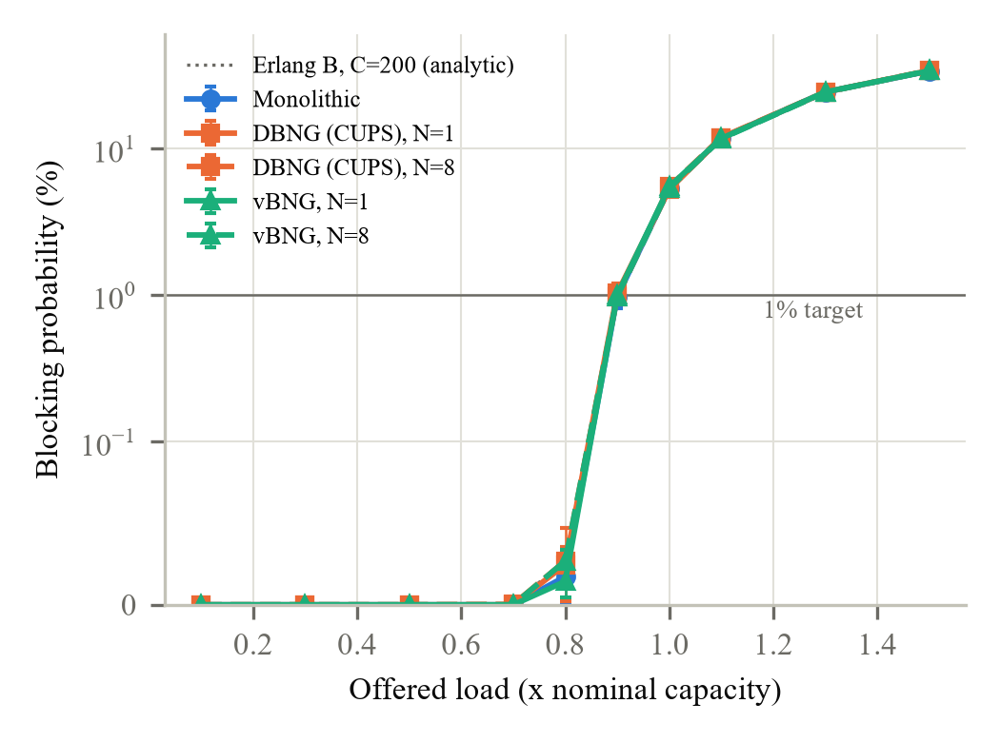
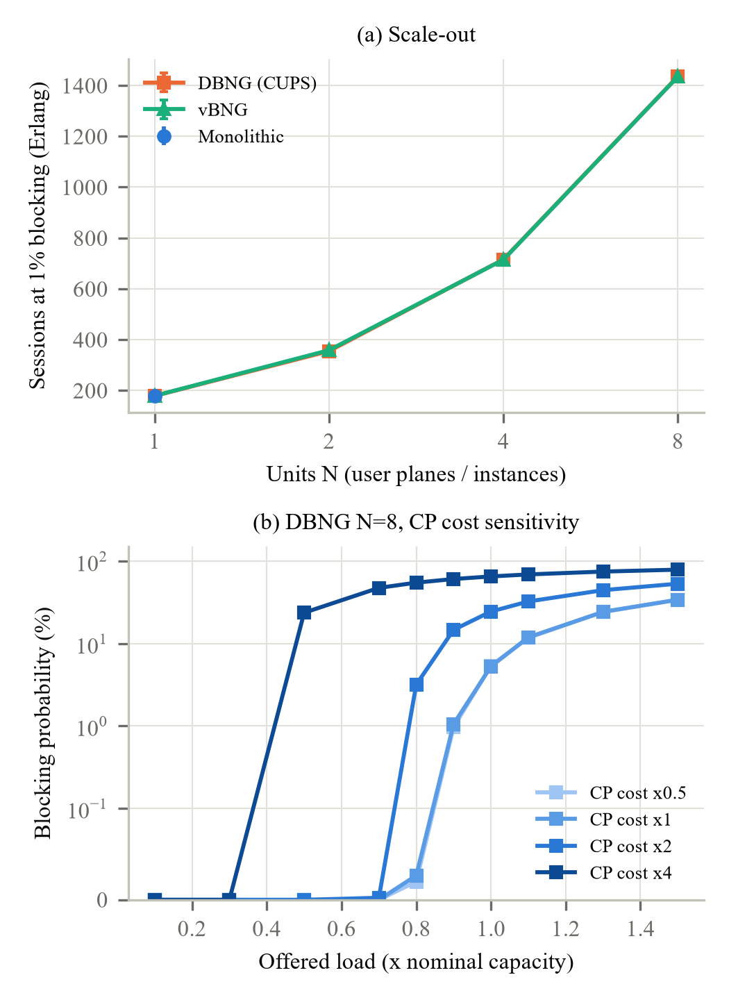
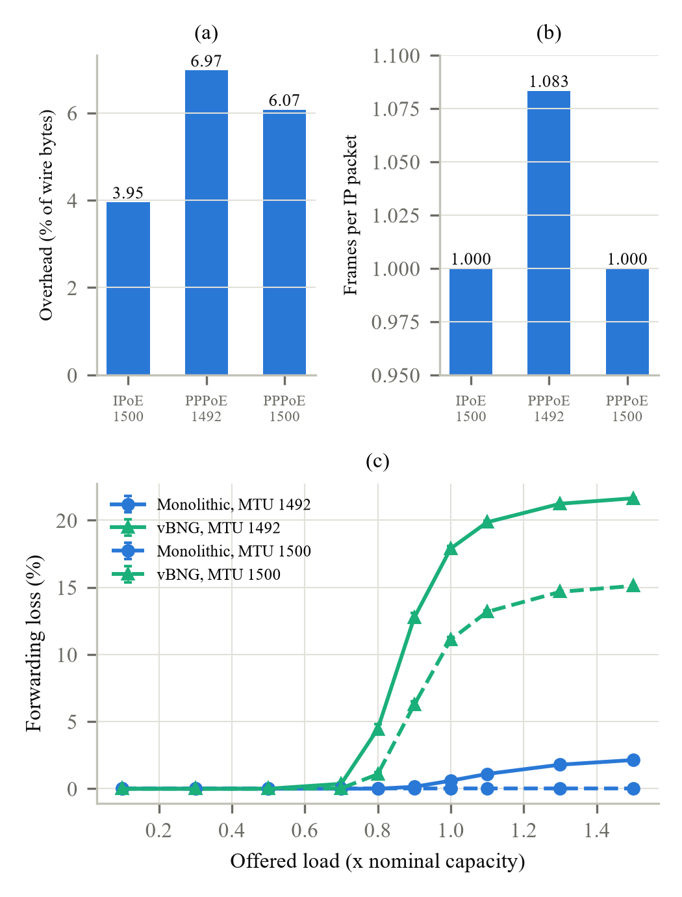

# Still Connected: A Simulation Study of PPPoE and 5WE Termination on Monolithic, Disaggregated, and Virtualized BNGs

Abstract— The Point-to-Point Protocol over Ethernet (PPPoE) still authenticates and connects a large share of broadband subscribers, and its frame format has been reused as the 5G Wireless-Wireline Convergence user plane encapsulation (5WE). Recent standards and operator trials move PPPoE termination from monolithic Broadband Network Gateways (BNGs) to disaggregated BNGs with control and user plane separation (CUPS) and to virtualized BNGs (vBNGs), but independent quantitative comparisons of these architectures are missing. This paper contributes a discrete-event simulation of subscriber session termination that compares a monolithic BNG, a CUPS-disaggregated BNG with one control plane and N in {1, 2, 4, 8} user planes, and a vBNG with N software instances, at 10 offered loads, two IP MTUs (1492 and 1500 bytes), and 30 independent replications per cell, with byte-exact PPPoE/5WE frames generated by the authors' validated frame codec. Simulated blocking matched the analytic Erlang B value within the 95% confidence interval at every load and did not differ significantly between architectures; every configuration sustained about 0.9 of its nominal session capacity at 1% blocking. Disaggregation added 66.7 ms to mean session setup through user-to-control-plane redirection, and with eight user planes on one control plane the control plane reached 60.5% utilization and the 99th-percentile setup latency rose to 317.9 ms at nominal load; doubling the control-plane cost saturated it and raised blocking to 3.17% at 0.8 load. The 1492-byte MTU increased frames per packet by 8.3% for the assumed packet mix and caused 2.14% forwarding loss at 1.5 load where the 1500-byte configuration lost none. All results are model-based and are stated with their assumptions.

Keywords—PPP, PPPoE, 5WE, Broadband Network Gateway (BNG), CUPS, Disaggregated BNG, vBNG, Discrete-Event Simulation, MTU, Session Setup Latency, Blocking Probability

## I. Introduction

Wide area network (WAN) connectivity depends on data link protocols that can establish, authenticate, and maintain links between geographically separated devices. The Point-to-Point Protocol (PPP), standardized in RFC 1661 in 1994, negotiates links through the Link Control Protocol (LCP), configures network layers through Network Control Protocols (NCPs) such as IPCP, and authenticates peers with PAP or CHAP. Its Ethernet variant, PPPoE (RFC 2516) [12], remains a common way for internet service providers (ISPs) to authenticate subscribers on DSL and fiber access networks, terminating each session on a Broadband Network Gateway (BNG) where the subscriber is authenticated, addressed, and given a policy [4], [6]. Every packet a PPPoE subscriber sends to the WAN therefore passes through a BNG, which makes the BNG a central point of both control and failure in fixed broadband access.

A literature review of PPP enhancements published from 2021 to 2026 (summarized in Section II) found that PPP is being extended rather than replaced, and that the scalability of the infrastructure that terminates PPPoE, not the protocol itself, is its main weakness. The same review found no recent independent, quantitative benchmarks comparing PPPoE termination on monolithic, disaggregated, and virtualized BNGs; most performance claims come from vendors and operators. This paper addresses that gap with a reproducible discrete-event simulation. The original research questions were:

- RQ1: What enhancements and updates have been made to PPP, its encapsulations, and the systems that terminate it in the last five years?
- RQ2: How have real-world implementations of PPP affected WAN connectivity, particularly in terms of scalability, flexibility, and service quality?

RQ1 is answered by the literature (Section II). The quantitative part of RQ2 is restated as two simulation questions:

- SQ1: At equal relative load, how do monolithic, CUPS-disaggregated (one control plane, N user planes), and virtualized (N instances) termination differ in session setup latency, blocking, and resource utilization, and where does each saturate?
- SQ2: What does PPPoE/5WE encapsulation at a 1492-byte IP MTU cost in frames, bytes, and forwarding headroom compared with the 1500-byte configuration enabled by RFC 4638 [11]?

The rest of the paper is organized as follows. Section II condenses the related work. Section III describes the system model, Section IV the simulation methodology and its validation, and Section V the results. Section VI discusses them against the reviewed deployments, Section VII lists threats to validity, and Section VIII concludes.

## II. Related Work

### A. Protocol Enhancements

RFC 8822 [1] defines the 5G Wireless-Wireline Convergence User Plane Encapsulation (5WE), which carries traffic between a 5G-capable residential gateway and the Access Gateway Function (AGF). It deliberately reuses the PPPoE session frame, keeping Ethertype 0x8864 and the field offsets so that deployed DSL access multiplexers and optical line terminals keep forwarding it; VER becomes 2, the CODE field carries the 5G QoS Flow Identifier and a Reflective QoS bit, SESSION_ID identifies a PDU session, and PPP signaling is replaced by 5G NAS procedures. The RFC notes that 5WE inherits PPPoE's MTU problem on 1500-byte Ethernet. Broadband Forum TR-456 Issue 2 and TR-470 Issue 2 [2] add multi-session support and legacy authentication models so that existing PPPoE customer equipment can be moved behind a converged 5G core.

Broadband Forum TR-459 [3] specifies a disaggregated BNG (DBNG) that separates the control plane (session handling, authentication, policy) from user planes using CUPS. A Control Packet Redirect Interface forwards PPPoE discovery and LCP packets from the user plane to the control plane, and PFCP manages subscriber state; Issue 2 adds multi-service deployments and user plane switchover. Proença et al. [4] review and prototype a virtualized BNG in which PPPoE termination runs as software on commodity servers, with the trade-off that data-plane performance must be carefully engineered. The pppd 2.5.x releases [5] add PEAP, IPv6 relay, PPPoE MTUs above 1492 bytes when both sides agree, and least-privilege defaults. Zhunussov et al. [6] show that PPPoE session statistics collected at a live BRAS can predict network quality with a Random Forest model.

### B. Case Studies

Deutsche Telekom's Access 4.0 program runs disaggregated BNG software on bare-metal switches and validates it with the open-source BNG Blaster, which emulates large numbers of PPPoE and IPoE subscribers [7]. Vodafone and four vendors completed a multi-vendor DBNG test based on TR-459 in 2021, with one vendor's control plane managing another vendor's user plane [8]. In Japan, congestion on centralized PPPoE termination in the FLET'S network pushed users to IPv6 IPoE, which reached 27% of download traffic by March 2021 [9] and about 16.15 million contracts by March 2023 [10]. The live-network study in [6] also shows PPPoE in production use.

### C. Gap

Across these sources the recurring theme is that the limiting factor is where PPPoE sessions are terminated. The DBNG and vBNG work [3], [4] and the DT and Vodafone deployments [7], [8] address this by separating and virtualizing termination, while the FLET'S case [9], [10] shows the cost of termination that cannot scale. None of the reviewed sources gives an independent quantitative comparison of the architectures, which is what the following sections provide under explicit modelling assumptions.

## III. System Model

### A. PPPoE and 5WE Data Frames

Table I compares the two data frames as they are built by the frame codec used in this study (ppp_5we_demo.py, reused unmodified by the simulator). The second header byte of 5WE carries QFI in its six most significant bits, RQI in bit 1, and a reserved zero in bit 0 [1]. LENGTH counts the 2-byte PPP Protocol ID, so the PPPoE/5WE encapsulation costs 6 + 2 = 8 bytes of Ethernet payload: a 1500-byte payload leaves a 1492-byte IP MTU, and a 1508-byte "baby jumbo" payload negotiated under RFC 4638 [11] restores 1500.

Table: Table I. PPPoE data header vs. 5WE header [1], [12]
| Field | PPPoE (RFC 2516) | 5WE (RFC 8822) |
|---|---|---|
| Ethertype | 0x8864 | 0x8864 (unchanged) |
| VER / TYPE | 1 / 1 | 2 / 1 |
| CODE (8 bits) | 0x00 for data | QFI (6 MSB), RQI (bit 1), reserved 0 |
| SESSION_ID | PPP session | 5G PDU session |
| LENGTH | Payload incl. 2-byte Protocol ID | Payload incl. 2-byte Protocol ID |
| Protocol ID | Any PPP protocol | 0x0021, 0x0057, or 0x0031 only |
| Session setup | PADI/PADO, PADR/PADS, LCP, PAP/CHAP, IPCP | 5G NAS procedures |

### B. Termination Architectures

Three architectures are modelled (Fig. 1). In the monolithic BNG, one chassis holds the session table, the control plane (CP), and the user plane (UP). In the DBNG, one CP serves N user planes; every setup message is redirected from the UP to the CP and back, and after IPCP the CP programs the UP with a PFCP session establishment. In the vBNG, N independent software BNGs each run their own CP and UP on a commodity server, and all of their processing is slowed by a virtualization overhead factor v. Each UP or instance (a "unit") has the same session table size as the monolithic chassis, so the nominal capacity of a configuration is N times that of one unit.

![Fig. 1. PPPoE termination in (a) a monolithic BNG and (b) a disaggregated BNG with control and user plane separation, based on [3]](original:fig1)

### C. Access-Node Transparency

The premise of 5WE is that access nodes classify frames by Ethertype and SESSION_ID and never inspect VER or CODE [1]. Two access-node models are therefore included: a legacy node that forwards on Ethertype and SESSION_ID, and a negative-control node that additionally polices VER = 1 and so drops 5WE. Both are behavioural models of the premise, not models of specific vendor firmware.

### D. MTU and Encapsulation

Forwarding cost is computed from the bytes of real frames. For each IP packet size in the traffic mix the simulator builds the PPPoE (or 5WE, which is byte-for-byte the same length) frames that carry it, fragmenting IPv4 packets larger than the MTU with the same rule as the codec's fragments() function: every fragment except the last carries a multiple of 8 data bytes. IPoE frames with a 1500-byte MTU are included as an unencapsulated reference.

## IV. Simulation Methodology

### A. Discrete-Event Design

The simulator is a session-level discrete-event simulation written in Python with the standard-library heapq event queue and a seeded Mersenne Twister generator. Sessions arrive as a Poisson process. Each subscriber is attached to one unit chosen uniformly at random, which models subscribers homed to geographically distinct user planes. A session-table slot is reserved at PADI; if the unit's table is full the session is blocked. The session then passes through five setup phases (PADI/PADO, PADR/PADS, LCP, PAP/CHAP with a RADIUS round trip, and IPCP). Each phase incurs its propagation delay, a job at the unit's punt queue, and a job at its CP queue. Both queues are single-server FIFO queues with exponential service and a finite waiting room; a setup that finds a full queue fails and is counted as blocked. Established sessions hold their slot for a lognormal holding time and then release it.

Forwarding is modelled as a fluid: every established session offers a constant IP rate, converted to frames per second and wire bits per second with the per-packet averages of the frame-level model. A unit delivers the offered traffic up to its packets-per-second (pps) and line-rate capacities, and the excess is counted as forwarding loss. The same replication (same seed) is evaluated at both MTUs, which gives a paired comparison with common random numbers.

### B. Parameters and Assumptions

Table II lists the parameters. They are assumptions chosen to be plausible and are varied in sensitivity runs; none is a vendor measurement. The session table is scaled down to 200 slots per unit and holding times are compressed to a 60 s mean with a coefficient of variation of 1.5, so that each replication covers at least 60 mean holding times within practical run time. Blocking in a loss system depends on the offered load and table size and, in steady state, not on the shape of the holding-time distribution, so this compression preserves blocking behaviour; it does, however, make signaling load per slot much higher than in real networks, so the control-plane utilizations reported here are pessimistic. The UP pps capacity is provisioned at 1.05 times the load of a full session table at MTU 1500 for the baseline packet mix (154.3 kpps per unit); a vBNG instance has the same nominal budget divided by v (123.4 kpps). The IP packet mix is 40, 576, and 1500 bytes in the ratio 7:4:1 by count, which assumes that 1/12 of packets are full-size because they are not subject to TCP MSS clamping; this share is varied in Section V-D.

Table: Table II. Simulation parameters
| Parameter | Value |
|---|---|
| Session table per unit | 200 sessions |
| Holding time | Lognormal, mean 60 s, CV 1.5 |
| Offered load | 0.1, 0.3, 0.5, 0.7, 0.8, 0.9, 1.0, 1.1, 1.3, 1.5 x N x 200 |
| Access RTT per phase | 2 ms |
| RADIUS RTT (PAP/CHAP) | 10 ms |
| DBNG UP-CP redirect RTT | 10 ms per phase |
| CP service per phase | 1, 1, 2, 10, 5 ms (mean, exponential) |
| DBNG PFCP establishment | 5 ms CP + 1 ms UP |
| UP punt service | 0.2 ms per message |
| Queue waiting room | 32 (UP punt), 64 (CP) |
| CP work per setup | 19 ms mono, 24 ms DBNG, 23.75 ms vBNG |
| vBNG overhead factor v | 1.25 |
| Offered IP rate per session | 2 Mbps |
| UP capacity | 154.3 kpps (vBNG 123.4 kpps), 1 Gbps |
| IP packet mix (bytes:count) | 40:7, 576:4, 1500:1 |
| Replication | 30 seeds, >= 10,000 measured arrivals, >= 60 mean holding times, 10% warm-up |

### C. Metrics

For every cell (architecture, N, load, MTU) the following are reported as the mean over 30 replications with a 95% Student-t confidence interval: mean, 95th-percentile, and 99th-percentile setup latency (PADI to IPCP completion, plus PFCP for DBNG); blocking probability split by cause (table full, UP queue, CP queue); delivered throughput in Mbps and kpps; IP goodput; forwarding loss; fragmentation ratio (share of IP packets fragmented); encapsulation overhead (non-IP bytes as a share of wire bytes); and CP, punt, and UP forwarding utilization. Sustainable sessions at 1% blocking are obtained per replication by linear interpolation of blocking against load. Differences between architectures are tested with Welch's t-test and MTU differences with a paired t-test, both at the 5% level.

### D. Validation

Four checks were run, and their outputs are archived with the results. First, the simulator's frame builder produced byte-identical output to ppp_5we_demo.py for 162 frames covering six IP sizes, three session IDs, and all combinations of four QFI values and both RQI values, and its frames match those in the demo's packet capture. Second, the number of fragments matched fragments() for 1400-, 1492-, and 1500-byte packets at both MTUs: only the 1500-byte packet at MTU 1492 is fragmented, into IP fragments of 1492 and 28 bytes (frames of 1514 and 50 bytes). Third, Little's law held within 0.001% for the CP queue and within 0.549% for the session table in every cell, and the measured CP utilization matched the product of admitted arrival rate and CP work within 0.388%. Fourth, simulated blocking for the monolithic BNG agreed with the analytic Erlang B value within the 95% confidence interval at all 10 loads (for example, 5.33 ± 0.37% simulated against 5.48% analytic at load 1.0). In the access-node experiment, the legacy node forwarded all 4976 5WE frames and all 5024 PPPoE frames unchanged, while the negative-control node dropped all 4976 5WE frames and forwarded all PPPoE frames.

A first run with replications of only 20 mean holding times failed the session Little's-law check by up to 3.8% and produced spuriously lower blocking for N >= 4; replications were lengthened to 60 holding times before any results were reported. That earlier run is not used anywhere in this paper.

### E. Reproducibility

All results are produced by one command, python experiments.py --all. Raw results (one row per replication and MTU) are stored in results/raw, aggregated results in results/summary, figures in figures/, and the commands, seeds, library versions, and checksums in results/MANIFEST.md. Every number reported below is taken from the summary files.

## V. Results

### A. SQ1: Setup Latency and Blocking

Fig. 2 shows setup latency against load. The monolithic BNG had a mean setup latency of 40.8 ms at load 0.5. Disaggregation added 66.7 ms (DBNG with N = 1: 107.5 ms), almost all of it the five UP-to-CP redirect round trips and the PFCP exchange; the difference was significant at every load. Virtualization added only 5.4 ms (vBNG N = 1: 46.2 ms), the effect of the overhead factor on CP and punt service times. Neither the monolithic BNG nor the vBNG showed load-dependent latency growth, because their per-unit control planes stayed below 8% utilization.

The DBNG with eight user planes behaved differently. Because one CP serves all eight units, its utilization grew with total load to 60.5% at nominal load, and queueing at the CP raised the mean setup latency from 121.4 ms at load 0.5 to 151.2 ms at load 1.0, and the 99th percentile to 317.9 ms, compared with 156.8 ms for a DBNG with one user plane at the same relative load.

Fig. 3 shows blocking. All architectures followed the Erlang B curve of a 200-slot table, reaching 1% at interpolated loads between 0.886 and 0.897 of nominal capacity and about 34% at load 1.5. No CP or punt queue overflowed in the baseline. The differences in blocking between monolithic and DBNG, monolithic and vBNG, and DBNG and vBNG with eight units were not statistically significant at any load (for example, at load 1.0 the Welch t statistic for DBNG versus vBNG with eight units was 1.26). In the baseline, therefore, the choice of architecture changes how long setup takes but not how many sessions are admitted.

### B. Scale-Out

Fig. 4(a) shows the sustainable sessions at 1% blocking. A monolithic BNG sustained 179.0 ± 1.4 sessions; eight DBNG user planes sustained 1435.0 ± 5.5 and eight vBNG instances 1434.6 ± 5.9, so both scaled almost linearly at about 0.9 of nominal capacity. The scale-out of the DBNG, however, rests on its single CP. Fig. 4(b) multiplies all CP service times. At half the baseline cost the eight-UP DBNG kept a mean setup latency of 102.0 ms at nominal load, and the baseline gave 151.3 ms in this sweep. At twice the cost the CP saturated (99.5% utilization at load 0.8), CP-queue overflow raised blocking to 3.17% at load 0.8 and 24.4% at load 1.0, and mean setup latency exceeded two seconds (2057.0 ms at load 0.8). At four times the cost it saturated already at load 0.5 with 23.6% blocking. The monolithic BNG with four times the CP cost reached only 24.0% CP utilization at nominal load and had no CP-queue blocking, because its CP serves one unit's sessions.

### C. SQ2: MTU and Encapsulation Overhead

Fig. 5(a) and (b) show the frame-level cost for the assumed packet mix. Encapsulation overhead was 3.95% of wire bytes for IPoE, 6.07% for PPPoE/5WE at MTU 1500, and 6.97% at MTU 1492. At MTU 1492 the 1500-byte packets are fragmented, so the fragmentation ratio was 8.3% and each IP packet needed 1.083 frames instead of 1.000, an increase of 8.3% in frames but only 0.97% in wire bytes. PPPoE and 5WE produced identical frame lengths at both MTUs.

Because UP capacity is bound by packets per second, the extra frames consume forwarding headroom. For the monolithic BNG at load 0.9, UP utilization was 91.5% at MTU 1492 and 84.6% at MTU 1500. At load 0.9 the 1492-byte configuration lost 0.143% of traffic and at load 1.5 it lost 2.14%, reducing goodput from 395.8 to 387.4 Mbps, while the 1500-byte configuration lost nothing; both differences were significant in the paired test. At load 0.5 the difference was zero and not significant. The vBNG, whose instances have 1/v of the pps budget, lost traffic at both MTUs once its tables filled: 12.7% at MTU 1492 and 6.25% at MTU 1500 at load 0.9 (Fig. 5(c)).

### D. Sensitivity Analysis

Four parameters were varied with 30 seeds each. Redirect RTT: for the DBNG with four user planes at load 0.9, mean setup latency was 69.7 ms with a 2 ms redirect RTT, 119.1 ms with 10 ms, and 301.5 ms with 40 ms, while blocking stayed near 1%; the redirect distance therefore sets the latency penalty of disaggregation. Virtualization overhead: for a vBNG with four instances at load 0.9, forwarding loss at MTU 1492 was 0.14% with v = 1.0, 3.15% with v = 1.1, 12.7% with v = 1.25, and 27.3% with v = 1.5, while setup latency rose only from 41.4 to 53.1 ms. CP cost: see Section V-B. Packet mix: with no full-size packets the 1492 MTU caused no fragmentation; with 25% full-size packets it added 25% more frames and 1.83% more wire bytes.

The holding-time shape was also varied for the monolithic BNG. With CV 0, 0.5, and 1.5, blocking at load 0.9 matched Erlang B within the confidence interval, as insensitivity predicts. With CV 3.0 blocking at load 1.1 was 9.25% against 11.89% analytic, which indicates that very heavy-tailed holding times do not reach steady state within the simulated horizon (Section VII).

Table: Table III. Results summary (load 1.0, MTU 1492 unless stated; mean of 30 replications)
| Configuration | Mean setup (ms) | p99 setup (ms) | Blocking (%) | CP util. (%) | Fwd. loss (%) |
|---|---|---|---|---|---|
| Monolithic | 41.5 | 85.6 | 5.33 | 6.0 | 0.60 |
| DBNG, N=1 | 108.9 | 156.8 | 5.26 | 7.6 | 0.56 |
| DBNG, N=8 | 151.2 | 317.9 | 5.47 | 60.5 | 0.55 |
| vBNG, N=1 | 47.3 | 103.0 | 5.48 | 7.5 | 17.9 |
| vBNG, N=8 | 47.3 | 103.3 | 5.34 | 7.5 | 17.9 |
| Monolithic, MTU 1500 | 41.5 | 85.6 | 5.33 | 6.0 | 0.00 |

## VI. Discussion

Centralized termination. In the model, a single termination point did not limit the number of admitted sessions until its own session table filled, and it had the shortest setup path. Its weakness is that it scales only as one unit: it sustained 179.0 sessions at 1% blocking, and more capacity means a larger chassis. This is consistent with the FLET'S case [9], [10], where centralized PPPoE termination that could not be expanded quickly became a bottleneck and traffic moved to IPoE; the simulation does not model that network, but it shows that blocking in a loss system rises steeply, from below 0.1% to above 5%, between loads 0.8 and 1.0, so a termination point operated close to its capacity has little margin.

CUPS. The DBNG scaled session capacity linearly with user planes, as the DT Access 4.0 and Vodafone deployments intend [7], [8], but the model exposes two costs. Each setup crosses the UP-CP redirect interface several times, so the CP's distance appears directly in setup latency (Section V-D). And a single CP is a shared resource whose load grows with the number of user planes: with the baseline cost it reached 60.5% utilization and doubled the 99th-percentile setup latency with eight user planes, and with twice the cost it saturated and blocked sessions. CP capacity therefore has to be planned for the total number of subscribers across all user planes, which is one reason TR-459 [3] allows the CP to run on scalable cloud infrastructure.

vBNG. Virtualization cost little in setup latency but, in this model, directly reduced forwarding headroom: if a software instance is given the same nominal packet budget as a hardware user plane, the overhead factor reappears as packet loss at high table occupancy. This matches the qualitative conclusion of Proença et al. [4] that vBNG data-plane performance must be engineered, and it quantifies how quickly the margin disappears as v grows.

MTU. The 8-byte PPPoE/5WE header raises byte overhead by less than one percentage point, but at a 1492-byte MTU any traffic that is not MSS-clamped is fragmented, and in a pps-bound forwarder the extra frames matter more than the extra bytes. RFC 4638 [11] support in pppd 2.5.3 [5] removes this cost when the access network carries 1508-byte payloads. Because 5WE reuses the PPPoE frame [1], it inherits exactly the same overhead and fragmentation, and the access-node experiment confirms that the reuse is what lets 5WE pass a node that inspects only Ethertype and SESSION_ID.

## VII. Threats to Validity

Model-based results. All results come from a discrete-event model; no hardware or production network was measured, and absolute values depend on the assumed parameters in Table II. The comparisons between architectures and the sensitivity trends are the intended results, not the absolute latencies.

Synthetic workload. Arrivals are Poisson, holding times are lognormal and compressed in time, the packet mix is assumed, and subscribers are attached uniformly at random. Reconnection storms after outages, which load the CP far more than steady-state churn, are not modelled. The compressed time scale makes CP load pessimistic relative to real networks.

Simplified mechanisms. Forwarding is a fluid model, so packet-level queueing delay and burst loss are not captured. Setup failures are not retried, PPPoE timers are not modelled, and propagation delays of a phase are lumped before it. The vBNG is modelled as a uniform slowdown factor, not as a particular hypervisor or packet-processing framework.

No vendor hardware. The parameters are not calibrated against any BNG product, and the access-node models represent the premise of RFC 8822 [1], not real DSLAM or OLT firmware.

Parameter sensitivity and horizon. The DBNG findings depend strongly on CP cost and redirect RTT (Section V-D). With a holding-time CV of 3.0, blocking did not converge to the analytic value within the simulated horizon, so results for extremely heavy-tailed sessions would require longer runs.

## VIII. Conclusion

This paper turned a qualitative review of PPP enhancements into a reproducible simulation study of PPPoE/5WE termination. RQ1 is answered by the reviewed literature: PPP is being extended through 5WE [1], AGF support for legacy subscribers [2], disaggregated [3] and virtualized [4] BNGs, pppd 2.5.x [5], and session-based monitoring [6]. For the quantitative part of RQ2, the simulation shows that, under the stated assumptions, all three termination architectures admit the same number of sessions per unit of session-table capacity, so disaggregation and virtualization scale capacity almost linearly with the number of units; that disaggregation pays for this with a fixed redirect latency and with a shared control plane whose utilization grows with the number of user planes and which becomes the bottleneck if its per-session cost is doubled; that virtualization overhead shows up mainly as lost forwarding headroom; and that the 1492-byte MTU costs few bytes but many extra frames for traffic that is not MSS-clamped, which RFC 4638 removes.

For network engineers, the results suggest dimensioning the DBNG control plane for the total subscriber population and placing it close to the user planes, provisioning vBNG packet budgets with the virtualization overhead in mind, and enabling 1508-byte PPPoE payloads where the access network allows it. Future work should calibrate the model on a hardware testbed, run the same scenarios with BNG Blaster [7] against real BNG implementations, and add reconnection storms and packet-level forwarding.

## References

[1] D. Allan, D. Eastlake 3rd, and D. Woolley, "5G Wireless Wireline Convergence User Plane Encapsulation (5WE)," RFC 8822, Apr. 2021, doi: 10.17487/RFC8822.
[2] Broadband Forum, "Broadband Forum achieves 5G convergence milestone," Business Wire, Mar. 17, 2022. [Online]. Available: https://www.businesswire.com/news/home/20220317005593/en/
[3] Broadband Forum, "TR-459 Issue 2: Multi-Service Disaggregated BNG with CUPS: Reference Architecture, Deployment Models, Interface, and Protocol Specifications," May 2023.
[4] J. Proença, R. Figueiredo, V. Pereira, T. Cruz, and P. Simões, "Contributions to the virtualization of the BNG," IEEE Access, vol. 13, pp. 18713–18733, 2025, doi: 10.1109/ACCESS.2025.3532548.
[5] ppp-project, "PPP (Paul's PPP Package) releases v2.5.0–v2.5.4," GitHub, 2023–2026. [Online]. Available: https://github.com/ppp-project/ppp/releases
[6] A. Zhunussov, A. Baikenov, T. Serikov, O. Abramkina, and Y. Vitulyova, "A statistical and machine learning analysis of the significant features of PPPoE sessions for quality monitoring," Eng. Technol. Appl. Sci. Res., vol. 15, no. 5, pp. 26923–26934, 2025, doi: 10.48084/etasr.12714.
[7] C. Giese, "BNG Blaster – Open source network tester," presented at DKNOG14, Copenhagen, Denmark, Mar. 7, 2024. [Online]. Available: https://events.dknog.dk/event/25/contributions/230
[8] Vodafone, "World first multi-vendor test of new broadband standard," Vodafone Group News, Sep. 29, 2021. [Online]. Available: https://www.vodafone.com/news/newsroom/technology/world-first-multi-vendor-test-new-broadband-standard
[9] BUSINESS NETWORK Editorial Dept., "IIJ reports traffic trends during the COVID-19 pandemic: IPoE traffic nearly doubles," BUSINESS NETWORK, Apr. 6, 2021 (in Japanese). [Online]. Available: https://businessnetwork.jp/article/8234
[10] S. Yamada, "Total nationwide IPv6 IPoE contracts reach about 16.15 million lines, announced by IPoE Council," INTERNET Watch, Jun. 21, 2023 (in Japanese). [Online]. Available: https://internet.watch.impress.co.jp/docs/news/1510189.html
[11] P. Arberg, D. Kourkouzelis, M. Duckett, T. Anschutz, and J. Moisand, "Accommodating a Maximum Transit Unit/Maximum Receive Unit (MTU/MRU) Greater Than 1492 in the Point-to-Point Protocol over Ethernet (PPPoE)," RFC 4638, Sep. 2006, doi: 10.17487/RFC4638.
[12] L. Mamakos, K. Lidl, J. Evarts, D. Carrel, D. Simone, and R. Wheeler, "A Method for Transmitting PPP Over Ethernet (PPPoE)," RFC 2516, Feb. 1999, doi: 10.17487/RFC2516.
